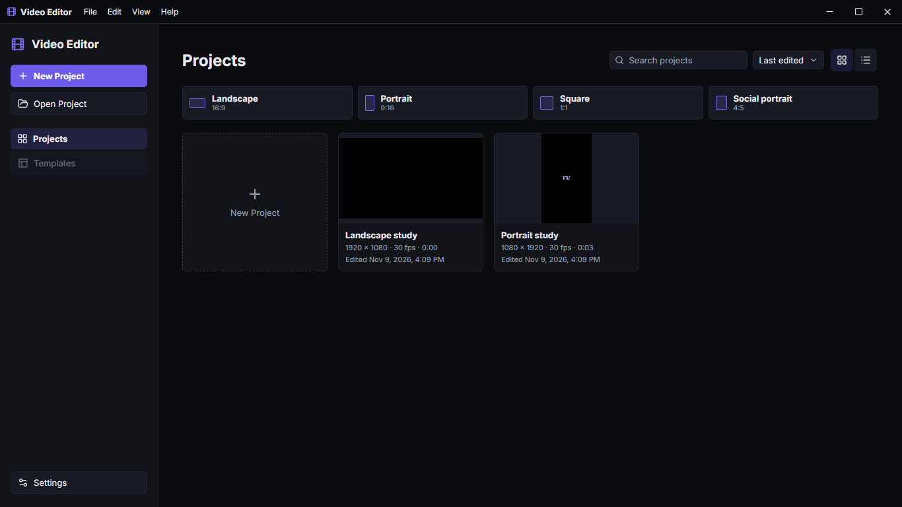
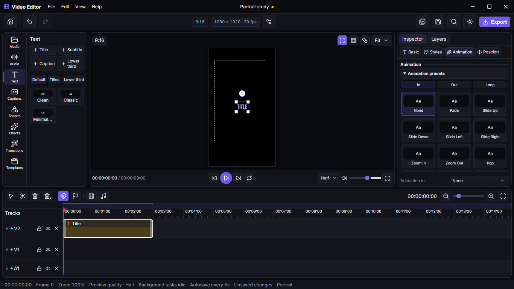

# Video Editor

A desktop video editor built with Electron, React 18, TypeScript, Vite, Tailwind, and Zustand.

## Workspace

Home shows recent projects in a grid or list, with ratio shortcuts for new projects. The editor has resizable side panels, a viewport toolbar, and a timeline overview. Use **Ctrl+wheel** to zoom around the pointer, **Shift+wheel** to pan horizontally, or middle-drag to pan both axes.

The Electron smoke suite checks the renderer at 1280×720, 1366×768, 1920×1080, and 2560×1440 with simulated device scale factors of 1, 1.25, and 1.5. Set `VIDEO_EDITOR_CAPTURE_UI=1` and run the viewport test to regenerate the screenshots.

## Setup

Install Node.js 22.12 or newer and run `npm ci`. Electron downloads a platform binary when first needed.

| Command | Purpose |
| --- | --- |
| `npm run dev` | Launch the desktop app with Vite |
| `npm run compile` | Build main, preload, and renderer bundles |
| `npm run build` | Package the app with electron-builder |
| `npm run lint` | Run ESLint |
| `npm run typecheck` | Check strict TypeScript |
| `npm test` | Run Vitest unit tests |
| `npm run e2e` | Build and run the Playwright Electron smoke test |
| `npm run sample` | Generate the layered demo project and its media |

The native build configuration targets NSIS on Windows, DMG on macOS, and AppImage on Linux. Build each target on the appropriate host. Windows builds appear in `release/`. Local release builds are unsigned unless a signing certificate is configured.

## Architecture

The renderer owns UI and active project state. A small typed API in the isolated preload connects it to the Electron main process, which owns dialogs, project files, settings, and the log. Projects use the versioned `.vedit` JSON contract in `05_project.schema.json`. Each new project folder contains the project file, a cache directory, and an exports directory.

The media bin imports local video, images, and audio using bundled FFmpeg and ffprobe. It stores thumbnails and preview proxies in the project cache.

## Text styles and animation

Select a text clip to open **Styles**. Choose a preset, then set **Animation in**, **Animation out**, and the duration. **Preview animation** plays the selected clip in the editor so you can check both ends before export.

The expanded workspace includes a caption dock, searchable Layers panel, command palette (**Ctrl+K**), and shortcut sheet (**?**). Choose **View → Layout** to override automatic landscape or portrait selection. Version 1 projects migrate to version 2 in memory and save in the new format.

See [Captions](docs/CAPTIONS.md) and [Animations](docs/ANIMATIONS.md) for workflows and extension points.

## Export

The renderer rasterizes styled text to transparent PNGs with the Canvas code used for preview. The main process builds an FFmpeg filter script from the project JSON and combines original media, PNG overlays, and the audio mix. It verifies staged output with ffprobe before publishing it. You can export video with audio, audio only, or both files in one run. Cancelling removes the staged output.

H.264 and HEVC exports probe NVENC, QSV, AMF, or VideoToolbox as appropriate for the host and retry in software if the hardware encode fails. Use **YouTube 4K60** for 3840×2160 at 60 fps. The bundled FFmpeg binary's license and build notices are in the `ffmpeg-static` package.

## Downloader development

Run `npm run downloader:prepare` to stage the pinned yt-dlp and Deno executables for your platform. The command uses curl and either tar on Windows or unzip on macOS and Linux. It verifies SHA-256 digests from the official release sources before staging files. The Windows build stages and bundles those tools automatically. D1 provides the metadata service and quality selection used by later downloader phases.

## Demo project

Run `npm run sample` and open `samples/Demo/Demo.vedit`. The generator writes local media and a three-second project with two videos, two images, three styled titles, and two audio tracks. Select **Export**, apply **YouTube 4K60**, then select **Both files** to produce an MP4 and MP3. The golden and Electron tests exercise these export paths and verify their output with ffprobe.

Project edits are checkpointed every 30 seconds by default. The start screen offers recovery after an interrupted session. If an original file has moved, use **Relink media** to select its replacement.

